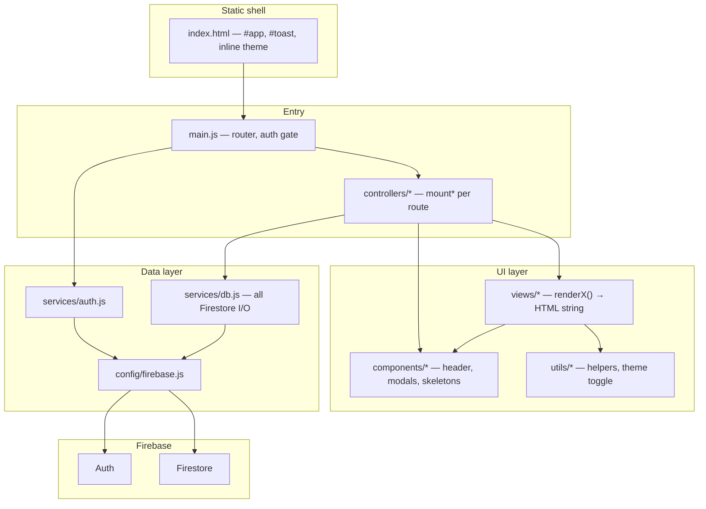

# Application architecture

This document describes **how the app is built**, not what it does. Use it as a blueprint to start another project with the same patterns.

---

## Summary

| Choice | What we use |
|--------|-------------|
| UI | **Vanilla JS** — no React/Vue/Svelte |
| Rendering | **HTML strings** mounted with `innerHTML` |
| Routing | **Hash-based** (`#/`, `#/list/:id`) — works on static hosts (GitHub Pages) |
| Backend | **Firebase Auth** + **Cloud Firestore** (client SDK only) |
| Build | **Vite** (ES modules, single CSS entry, `?raw` assets) |
| Hosting | **GitHub Pages** — CI builds `dist/` and deploys on push |
| Security | **Firestore rules** enforce access; UI uses `escapeHtml` for user text |

There is **no global state library**. Each “screen” keeps local variables, subscribes to Firestore, and re-renders when data changes.

---

## Layer model



**Rule:** `views/` and `components/` never import Firestore directly. All reads/writes go through `services/`.

---

## Repository layout (template)

Copy this shape for a new app; rename domains (`checklists` → your collections).

```
project/
├── index.html                 # #app mount, #toast, theme script in <head>
├── .env.example               # VITE_FIREBASE_* keys; copy to .env.local (gitignored)
├── eslint.config.js           # npm run lint — also runs in CI
├── firestore.rules            # Deploy separately: firebase deploy --only firestore:rules
├── firestore.indexes.json
├── vite.config.js             # base: "/RepoName/" for GitHub Pages subpath
│
├── src/
│   ├── main.js                # Single entry: CSS import, router, auth gate
│   ├── controllers/
│   │   ├── shared.js          # #app helpers, settle gate, cross-page actions
│   │   └── *.js               # export function mountPage(...) → cleanup fn
│   ├── config/
│   │   └── firebase.js        # initializeApp, auth, db exports
│   ├── services/
│   │   ├── auth.js            # onAuthStateChanged wrapper, sign-in/out
│   │   └── db.js              # subscribe*, get*, create/update/delete
│   ├── views/
│   │   └── *.js               # export function renderPage(...) { return `...`; }
│   ├── components/
│   │   ├── layout.js          # Shared chrome (header, avatars)
│   │   ├── modal.js           # Generic dialog host on document.body
│   │   ├── popups.js          # Feature-specific modals built on modal.js
│   │   └── skeletons.js       # Loading HTML for each major layout
│   ├── utils/
│   │   ├── helpers.js         # escapeHtml, toast, dates, small parsers
│   │   └── theme.js           # Toggle + sync with index.html inline script
│   └── styles/
│       ├── index.css          # @import order only
│       ├── base/              # tokens, dark theme, reset, typography, motion
│       ├── layout/            # shell, responsive breakpoints
│       ├── components/        # one file per UI primitive
│       └── pages/             # page-specific layout CSS
│
├── mockup/                    # Optional: static HTML/CSS spec (not deployed)
├── docs/                      # Maintainer docs (not deployed)
└── .github/workflows/         # npm ci → npm run build → deploy-pages
```

---

## Application shell (`index.html`)

- **`#app`** — entire routed UI is replaced here (`innerHTML`).
- **`#toast`** — global feedback; updated outside full re-renders when useful.
- **Inline theme script in `<head>`** — sets `document.documentElement.dataset.theme` from `localStorage` or `prefers-color-scheme` **before first paint** (avoids flash). Keep logic in sync with `utils/theme.js`.
- **Single module entry:** `<script type="module" src="/src/main.js">`.

No server-side rendering. No HTML templates on the server.

---

## Entry point and routing (`main.js`)

### Bootstrap order

1. Import global CSS once.
2. `initThemeToggle()` (delegated listener on `document`).
3. `watchAuth(callback)` — when user changes, store `currentUser` and call `route()`.
4. `window.addEventListener("hashchange", route)`.
5. Initial `route()`.

### Hash router

- Parse `location.hash` (default `#/` → home).
- **`navigate(path)`** sets `location.hash` (e.g. `#/list/abc`).
- On every route change:
  - `closeModal()` — don’t leave dialogs open across routes.
  - `unsettle()` — reset animation gate (see below).
  - Call previous route’s **`unsubRoute()`** — unsubscribe Firestore listeners, clear timers.

### Auth gate

Inside `route()`:

- If Firebase config missing → sign-in view with error state.
- If no user → sign-in view.
- Else → `mountHome(user)` or `mountList(user, id)` based on parsed route.

Sign-in page re-renders itself for loading/error without touching authenticated mounts.

---

## Page controller pattern (`mount*`)

Each route is a **function** in its own file under `controllers/` (e.g. `mountHome`, `mountGroup`), not a class. It **returns its cleanup function**; the router stores it as `unsubRoute`.

Typical responsibilities:

| Responsibility | Pattern |
|----------------|---------|
| Local state | `let` variables in closure (`lists`, `items`, `editingId`, …) |
| Live data | `subscribe*(…)` from `services/db.js`; callback updates state and calls `render()` / `rerender()` |
| First paint | Show **skeleton** until required data exists (`null` vs `[]` matters) |
| UI | Call `renderView(...)` from `views/`, then `setApp(html)` |
| Events | After mount, `querySelector` + `addEventListener` on `[data-action=…]`, `[data-item-id]`, etc. |
| Cleanup | `return () => { unsubs.forEach(...); clear timers; }` |

**Re-render model:** Firestore `onSnapshot` → update in-memory arrays → full `#app` HTML replace → re-bind events. Simple and predictable; acceptable for this app size.

**Animation gate:** `settle()` sets `#app[data-settled="1"]` after ~600ms so CSS entry animations don’t replay on every snapshot. `unsettle()` on route change.

---

## Views (`views/*.js`)

- Export **`renderPageName(...)`** returning a **template string** of HTML.
- Pure presentation: receive data + UI flags (e.g. `editingId`, `loading`); no side effects.
- Use **`escapeHtml()`** for any user- or Firestore-sourced text in HTML.
- Shared chrome via **`renderHeader(user)`** from `components/layout.js`.
- Interactivity is **declarative hooks** only, e.g.:
  - `data-action="sign-out"`
  - `data-action="add-tasks"`
  - `data-link` for in-app hash links (if you wire them)
  - `data-edit-item="${id}"` for per-row actions

`controllers/` are the only place that attaches listeners to those hooks.

---

## Components

| Type | Role |
|------|------|
| **layout.js** | App header, avatars, repeated shell fragments |
| **modal.js** | Create backdrop on **`document.body`**, outside `#app` |
| **popups.js** | Compose modal content for specific flows |
| **skeletons.js** | Return loading HTML matching **desktop + mobile** layout shapes |

### Why modals live outside `#app`

`#app` is wiped on every Firestore-driven re-render. Modals mount on `<body>` so typing in a textarea isn’t lost when a listener fires.

Modal contract (`modal.js`):

- One open at a time; `closeModal()` on route change.
- Close: backdrop click, Escape, `[data-close]`, ✕ button.
- Return root element so callers can bind submit/count logic.

---

## Services layer

### `config/firebase.js`

- Read public config from `VITE_FIREBASE_*` env vars (`.env.local` locally, GitHub Secrets in CI).
- Export `configMissing`, `auth`, `db`, providers.
- Guard: if config missing, skip `initializeApp` (app shows setup message).

### `services/auth.js`

- Thin wrapper: `watchAuth`, `signInWithGoogle`, `signOutUser`.
- Post-login side effects (e.g. claim invites) run inside auth callback before notifying `main.js`.

### `services/db.js`

- **All** Firestore: `onSnapshot` subscribers, one-shot `getDoc`, batches, `writeBatch`.
- Views/main call named functions — never raw `collection()` in UI code.
- Subscribers return unsubscribe functions passed up to `mount*` cleanup.

Naming convention:

- `subscribe*` → live listener.
- `get*Once` → single read (bootstrap, permissions check).
- `create*` / `update*` / `delete*` → writes with validation errors thrown as `Error` messages for toast.

---

## Real-time and loading states

1. **Skeleton first:** If required docs aren’t loaded yet (`items === null`, empty `members`), render `checklistSkeleton()` (or home equivalent) with `aria-busy="true"`.
2. **Listeners:** Attach after mount; each snapshot maps docs to `{ id, ...data() }` arrays.
3. **Optimistic UI (optional):** Local flags (`poppedId`, `leavingIds`, `freshIds`) passed into view for animation; cleared on timer or next snapshot.
4. **Derived data:** Expensive per-row stats can be cached in `Map` keyed by `updatedAt` (see home list summaries) to avoid redundant reads.

---

## Styling architecture

Single entry: **`src/styles/index.css`** imported from `main.js`.

Import order (do not reorder casually):

1. **base/** — `tokens.css` (CSS variables), `theme-dark.css` (`[data-theme="dark"]`), reset, typography, motion + `prefers-reduced-motion`
2. **layout/** — app shell (header, blobs)
3. **components/** — buttons, modal, toast, skeleton, …
4. **pages/** — route-specific layout
5. **components that override pages** — e.g. `item-card.css` after page rules
6. **layout/responsive.css** — breakpoints last (e.g. `.mobile-only`, `.checklist-board--desktop`)

**Conventions:**

- Colours/spacing/radii from **`var(--…)`** in `tokens.css`; no hard-coded hex in new CSS.
- New primitive → new file under `components/` + one `@import` in `index.css`.
- Dark mode: override tokens in `theme-dark.css`, not duplicate components.

---

## Security and trust boundaries

| Layer | Responsibility |
|-------|----------------|
| **Firestore rules** | Authoritative: who can read/write which paths |
| **UI** | `escapeHtml` on all untrusted strings in HTML; validate before write in `services/` |
| **Config** | `firebase-config.js` is public; security is rules + Auth, not hidden keys |

Deploy rules explicitly; they are **not** part of the GitHub Pages build.

---

## Build and deploy

### Vite

- **`base`** in `vite.config.js` must match GitHub Pages project path (`/MyChecklist/`).
- Assets and hashed bundles live under `dist/assets/`.
- SVGs can be imported with **`?raw`** for inline HTML/SVG in views.

### GitHub Actions

On push to `master` / `main`:

1. `npm ci`
2. `npm run build`
3. Upload `dist/` as Pages artifact and deploy.

Local: `npm run dev` (dev server with same `base`), `npm run preview` for production build smoke test.

---

## Optional: static mockup folder

`mockup/` holds **non-JS** HTML/CSS prototypes. They are the design contract; production code in `src/` follows the same class names and structure where possible. Mockups are not deployed.

---

## Starting a new project with this architecture

1. **Scaffold** Vite vanilla template; set `base` for your Pages URL.
2. **Add** `index.html` shell (`#app`, `#toast`, theme inline script).
3. **Create** `src/config/firebase.js` + root `firebase-config.example.js`.
4. **Implement** `services/auth.js` and `services/db.js` before any view.
5. **Add** `main.js` with hash router, auth gate, and one `mountHome` skeleton.
6. **Add** one view returning HTML string + skeleton + `styles/` tree with tokens.
7. **Wire** modals on `body` before you need forms that survive re-render.
8. **Write** Firestore rules and indexes; deploy with Firebase CLI.
9. **Add** `.github/workflows/deploy-pages.yml` when ready to ship.

Keep the **separation**: router in `main.js`, controllers in `controllers/`, strings in `views/`, I/O in `services/`, design tokens in CSS, rules on the server.

---

## Related docs

- [`session-handoff.md`](./session-handoff.md) — current product status and decisions (not architecture).
- [`firebase-github-setup.md`](./firebase-github-setup.md) — Firebase + GitHub one-time setup.
- Root [`README.md`](../README.md) — quick start and folder map.
